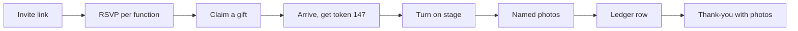
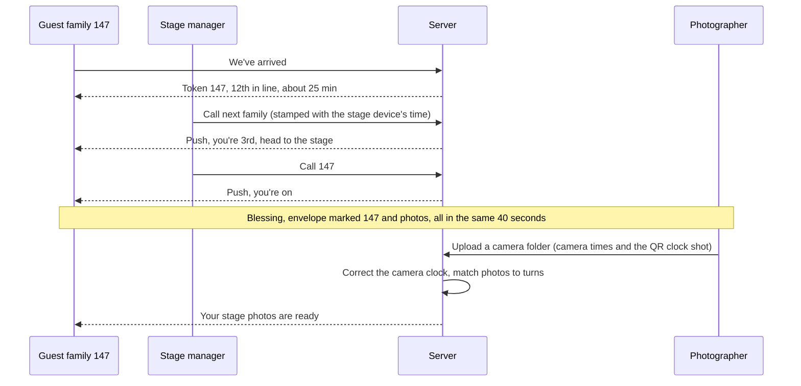
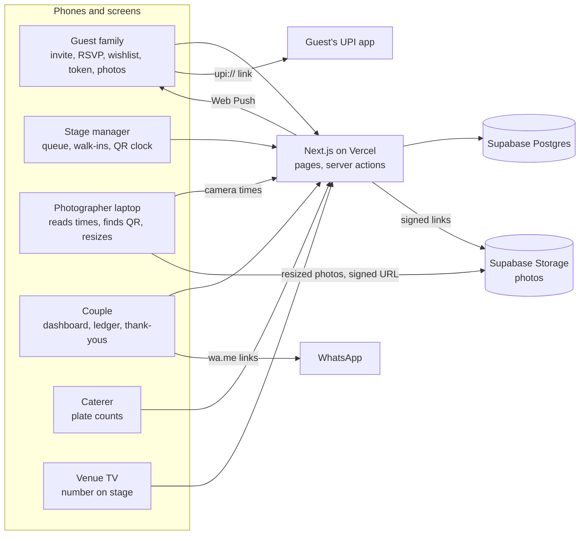

# Pehle Aap

**One link per guest family, from the wedding invite to the thank-you note.**

*Pehle aap* is Hindi for "after you", the polite way to offer someone your turn.

Festive Hacks 2026 · Theme: **Wedding season** · Indian wedding terms are explained in the [glossary](#glossary) at the end.

---

## 1. The problem

An Indian wedding runs over several days for hundreds of guests. The family manages it through WhatsApp forwards and a paper notebook, and the same things go wrong at every wedding.

**Before the wedding: gifts and headcounts**
- Guests don't know what the couple needs, and nobody knows what anyone else is bringing. So gifts default to safe, old-fashioned choices. The running joke is the couple who receives seven pressure cookers. Asking the couple directly feels awkward.
- RSVPs are a casual "haan, aayenge" ("yes, we'll come"), so the caterer guesses the plate count for every function. If they guess high, food is wasted. If they guess low, the hosts are embarrassed in front of everyone.

**On the day: the stage line**
- At the reception, every family wants a turn on stage to bless the couple, hand over the shagun envelope and get one photo. With hundreds of families, the line routinely runs 30–60 minutes or more.
- Elders stand through it, and people cut in. Guests who have a second wedding to reach that night (common on peak dates) give up and leave. The couple stands for hours.

**After the wedding: photos, envelopes and thank-yous**
- The photographer has hundreds of stage photos and no names. The couple can't tell one uncle from another, and most guests never see their own photo with the couple.
- Envelopes pile up in a bag. Some say "Sharma family" (which Sharma?) and some say nothing. Gift tags fall off backstage. Late at night the family sits on the floor and writes the lena-dena diary (who gave what) by hand. Meanwhile, UPI shagun sits scattered in someone's payment history.
- Thank-you notes rarely get sent, because nobody can face writing 400 individual messages.

**Root cause.** Every tool in the chain works on its own: the e-invite image, the WhatsApp group, the photographer's memory card, the envelope bag and the notebook. None of them knows *who* a guest is across the whole wedding, so the family has to connect everything by hand.

**Why now.** Wedding season opens on 21 November 2026, the day after Dev Uthani Ekadashi. The most-cited wedding dates this month are 21, 24, 25 and 26 November, so the Festive Hacks finals on the 25th fall on a muhurat (auspicious wedding date).

---

## 2. The solution

Pehle Aap gives every guest family **one record and one link** that follow them through the whole wedding:



The idea that makes this work is the stage. **The blessing, the envelope and the photo all happen in the same 40 seconds.** If the system knows which family was on stage at each moment, everything from that moment can be linked to that family without anyone typing a name.

| Problem | Feature | How it's solved |
|---|---|---|
| Duplicate, unwanted gifts | **Gift wishlist** on the invite | The couple lists what they need. When a guest claims an item, it's instantly locked for everyone else. Other guests see only "taken". |
| Caterer guesses plates | **Plate counts** | Planned plates per function come from RSVP headcounts plus a safety margin. On the day, the same QR check-in that issues stage tokens gives the kitchen a live arrival count. |
| The stage line | **Token queue** | Families check in, get a token number and an estimated wait, and go eat. Their phone tells them when to come. Elders and early leavers move up, under a rule that never makes anyone wait forever. |
| Unnamed stage photos | **Photos that name themselves** | The photographer takes one photo of a QR clock with each camera, which corrects that camera's clock. Each photo is then matched to the family that was on stage at that second. No face recognition is used. |
| The envelope bag | **Self-filling ledger** | Guests write their token number on the envelope or gift tag and in the UPI note. On counting night you type "147 → ₹2,100". Wishlist claims are added automatically. |
| No thank-yous | **One-tap thank-you notes** | Each tap opens WhatsApp with a personal message that names the family's gift and links to their stage photos. |

**How it's different**
- A shagun ledger normally needs someone to type every name. This one fills itself from the stage.
- Existing wedding photo apps (Kamero, Samaro and others) use face recognition so a guest can find their own photos. Pehle Aap tells the *couple* who is in every stage photo, using only time and no biometrics.
- An e-invite is usually a static image or video. Here the invite becomes the guest's pass for the whole wedding.
- There's nothing to install. Guests need only one link and one QR code.

### Who uses it

| Role | Device | What they get |
|---|---|---|
| Couple / host | Phone or laptop | A dashboard with functions, wishlist, RSVPs, plate counts, album, ledger, thank-yous and the links for each role |
| Guest family | Their own phone, no install | A family page. Before the wedding: invite, RSVP and wishlist. On the day: their token and place in the queue. Afterwards: their photos |
| Stage manager (usually a cousin) | Phone or tablet | Buttons to call the next family, skip, pause and add walk-ins, plus the QR clock |
| Photographer | Laptop | Uploads one camera's folder at a time. The clock correction happens automatically |
| Caterer | Phone | Plates per function, and live arrivals on the day |
| Venue TV | Any browser | The number on stage now and the next few numbers |

---

## 3. How the pieces connect

Four things carry a family's identity through the system:

1. **The family record.** It's created when a family RSVPs, or when they walk in on the day. It holds their name, phone number, side (bride's or groom's) and whether elders are with them.
2. **The family link** `/f/<key>`. The same link works before, during and after the wedding, and the page changes with the date. Before the wedding it shows the invite, RSVP and wishlist. On the day it shows a "We've arrived" button, the token and the queue. Afterwards it shows their photos.
3. **The token number** (say, 147). It's assigned at the family's first check-in and is the part people actually use. It appears on the venue TV, gets written on envelopes and gift tags, goes into UPI notes and is typed in on counting night.
4. **Stage time.** The stage manager's device records the time of every "call". That device's clock is the single timeline for the event: the QR clock displays it, and every photo's time is converted to it.

Wishlist claims link to the family directly. Envelopes, gift boxes and UPI payments link through the token number. Photos link through stage time. The ledger is simply a view of the family record with everything attached.

The stage moment, end to end:



---

## 4. Architecture



### Design principles

- **The browser does the heavy lifting.** Reading photo timestamps, decoding the QR clock and resizing photos all happen on the photographer's laptop. The server only stores small pieces of metadata and does the matching.
- **The database is never exposed.** All reads and writes go through server code. Row Level Security (Supabase's per-row access rules) is switched on with no rules defined, so even Supabase's public key can't read or write a row.
- **Polling, not websockets.** Banquet halls have poor mobile signal. While a guest's page is open it asks the server for an update every 5 seconds, and when the phone is in a pocket the guest gets push notifications instead. If the connection drops, the next request simply catches up.
- **No accounts.** Each role and each family gets an unguessable link. Guests live in WhatsApp, and a sign-up screen would lose most of them.
- **No money, no faces.** UPI payments happen in the guest's own app, and photos are matched by time, not biometrics.

### Tech stack

| Layer | Choice | Why |
|---|---|---|
| App | **Next.js** (App Router) + TypeScript | Pages, server actions and API routes in one deployment. `next/og` draws the preview card WhatsApp shows for the invite link |
| UI | Tailwind CSS | Quick to style and mobile-first by default |
| Database | **Supabase Postgres** | Real SQL. Gift claims and token numbers are safe in a single statement, and per-function totals are one query |
| Photo storage | **Supabase Storage** (private bucket) | Signed upload URLs let the browser upload directly. Vercel functions limit request bodies to 4.5 MB, so photos can't go through our server |
| Hosting | **Vercel** | Zero configuration for Next.js, and HTTPS, which service workers and push notifications require |
| Photo timestamps | **exifr** (in the browser) | Reads only the start of each file, so a folder of 20 MB JPEGs is read in seconds |
| QR reading | **jsQR** (in the browser) | Finds the clock QR in the calibration photo |
| QR generation | **qrcode** | The entrance QR, the QR on the TV board and the stage QR clock |
| Resizing | Canvas, built into every browser | No library needed |
| Notifications | Web Push API + service worker, with **web-push** on the server | Guests can go and eat while their phone tells them when to come, with no app to install |
| Live updates | `fetch` every 5 s while the page is visible | Works on bad venue networks, with no websocket server to run |
| WhatsApp | `wa.me` click-to-chat links | Invites and thank-yous are sent from the couple's own number, with no API approval needed |
| UPI | `upi://pay` links and the couple's UPI QR code | Money never passes through the app |
| Tests | Node's built-in test runner + Playwright | Unit tests for the queue and the photo matcher, plus one end-to-end journey test |

### Data model

```sql
create table wedding (
  id            uuid primary key default gen_random_uuid(),
  slug          text unique not null,               -- /i/riya-weds-arjun
  couple        text not null,
  upi_id        text,                               -- where UPI shagun goes
  next_number   int not null default 101,           -- token counter
  plate_margin  numeric not null default 0.10,      -- caterer safety margin, set by the couple
  host_key      text unique not null,               -- role links: 16 random bytes, base64url
  stage_key     text unique not null,
  upload_key    text unique not null,
  kitchen_key   text unique not null
);

create table event (                                -- one per function: Haldi, Sangeet, Reception...
  id          uuid primary key default gen_random_uuid(),
  wedding_id  uuid not null references wedding on delete cascade,
  name        text not null,
  starts_at   timestamptz not null,
  venue       text,
  map_url     text,
  has_stage   boolean not null default false,       -- runs the token queue
  started_at  timestamptz                           -- couple tapped "Start": the day-of view goes live
);

create table family (
  id          uuid primary key default gen_random_uuid(),
  wedding_id  uuid not null references wedding on delete cascade,
  link_key    text unique not null,                 -- /f/<link_key>
  name        text not null,
  phone       text,
  side        text check (side in ('bride', 'groom')),
  elders      boolean not null default false,       -- someone 75+: earlier due time in the queue
  number      int,                                  -- token, assigned at first check-in
  cash        int,                                  -- ledger, filled in on counting night
  upi         int,
  boxed_gift  text,
  thanked_at  timestamptz,
  unique (wedding_id, phone),
  unique (wedding_id, number)
);

create table rsvp (
  family_id  uuid references family on delete cascade,
  event_id   uuid references event on delete cascade,
  headcount  int not null check (headcount >= 0),
  primary key (family_id, event_id)
);

create table checkin (                              -- on the day: one row per family per function
  family_id   uuid references family on delete cascade,
  event_id    uuid references event on delete cascade,
  headcount   int not null,
  arrived_at  timestamptz not null default now(),
  leave_by    timestamptz,                          -- "we must leave by 10:30"
  in_line     boolean not null default true,        -- wants to go on stage
  called_at   timestamptz,                          -- stage device clock
  skipped     boolean not null default false,
  push        jsonb,                                -- Web Push subscription
  primary key (family_id, event_id)
);

create table stage_log (                            -- append-only, so an offline stage screen can replay it
  id         uuid primary key,                      -- made on the device, so retries are harmless
  event_id   uuid not null references event on delete cascade,
  at         timestamptz not null,                  -- stage device clock: the event's one timeline
  action     text not null check (action in ('call', 'skip', 'pause', 'resume')),
  family_id  uuid references family
);

create table gift (
  id          uuid primary key default gen_random_uuid(),
  wedding_id  uuid not null references wedding on delete cascade,
  name        text not null,
  link        text,
  price_band  text,
  claimed_by  uuid references family on delete set null,
  claimed_at  timestamptz
);

create table batch (                                -- one camera's upload
  id         uuid primary key default gen_random_uuid(),
  event_id   uuid not null references event on delete cascade,
  camera     text,
  offset_ms  bigint                                 -- stage clock minus camera clock
);

create table photo (
  id         uuid primary key default gen_random_uuid(),
  batch_id   uuid not null references batch on delete cascade,
  path       text not null,                         -- object in the private photos bucket
  camera_at  timestamp not null,                    -- the camera's own clock, as recorded, no time zone
  family_id  uuid references family on delete set null
);
```

---

## 5. Module deep-dives

### 5.1 Digital invite and RSVP

- **Setup.** The couple creates the wedding: names, a photo, the functions (name, date and time, venue, map link), the UPI ID for shagun, and the wishlist.
- **Most guests come in through the shared invite link** `/i/<slug>`, posted in family WhatsApp groups. They tap RSVP, enter their family name, phone number and side, and land on their personal family link. The device remembers it, and the page tells them to keep it because it's their pass on the wedding day.
- **The couple can add a family by hand**, for example grandparents without smartphones, and send their personal link with one tap through `wa.me`.
- **RSVP is per function**, for example "How many of you are coming to the Sangeet? The reception?" One extra question feeds the queue: "Is anyone 75 or older?" Guests can change their answers at any time.
- **A phone number can register only once per wedding.** If it's already registered, the page says so and points the guest to their original link, which the couple can resend. Typing someone else's number never opens their page.
- **The link looks like a card on WhatsApp.** `next/og` generates the preview image from the couple's names, date and photo. Keep the image small, because WhatsApp skips large preview images.

### 5.2 Gift wishlist

- **What the couple lists.** Each item has a name, an optional shop link and a price band. **"Shagun (cash or UPI)" is always the first option**, so the list reads as a suggestion, never a demand. A list of "required" items on an Indian wedding invite can look like a dowry list, so the product avoids that wording everywhere.
- **What guests see.** Each item shows as available or "taken", never who took it.
- **Claims can't collide.** Claiming is a single atomic statement, so two guests tapping the same item at the same moment can't both win:

  ```sql
  update gift set claimed_by = $family, claimed_at = now()
  where id = $gift and claimed_by is null
  returning id;   -- no row back: someone else got there first, so show "just taken"
  ```
- **Two of something?** List it twice, so each claim still locks only one row.
- **Releasing claims.** Guests can un-claim their own item, and the couple can release any claim, for example when a guest claimed something and never bought it.
- **Claims feed the ledger.** They appear under that family automatically. Even if the tag falls off the box backstage, the couple knows who brought the air fryer.

### 5.3 Plate counts for the caterer

- **Before the day.** For each function the kitchen view shows the confirmed headcount from RSVPs, how many families haven't answered, and a suggested order of confirmed × (1 + margin). The couple sets the margin (10% by default), because every family's "haan, aayenge" means something different.

  ```sql
  select e.name,
         sum(r.headcount)                               as confirmed,
         ceil(sum(r.headcount) * (1 + w.plate_margin))  as plates_to_order
  from rsvp r
  join event e   on e.id = r.event_id
  join wedding w on w.id = e.wedding_id
  where w.id = $wedding
  group by e.id, w.id
  order by e.starts_at;
  ```
- **On the day.** Every check-in records how many people actually came. The kitchen view shows arrivals against the plan, and how many people arrived in the last 15 minutes, so the kitchen can see a rush coming. The arrival figure is a minimum, not an exact count, because guests who never check in aren't included.
- **One scan, two jobs.** The QR check-in that gives a family its stage token also updates the kitchen's count.

### 5.4 Check-in and the token queue

**Arriving**
- **Families with a link** tap "We've arrived", confirm how many came, and can add "we must leave by 10:30".
- **Walk-ins** scan the entrance QR (`/here/<slug>`) and enter their family name, side and headcount. If the phone number matches a registered family, that family is checked in. This phone then shows only their token number and live place in the line, taken from the public TV board feed, not the full family page.
- **Guests without a smartphone** are added by the stage manager, who tells them their number.
- **Token numbers never repeat.** They come from an atomic counter, so two families checking in at the same second never get the same number:

  ```sql
  update wedding set next_number = next_number + 1
  where id = $wedding
  returning next_number - 1 as number;   -- the row lock lines up simultaneous check-ins
  ```

**Who goes next: the due-time rule**

Every family in line gets a *due time*, which is when they should ideally be on stage. The stage serves the earliest due time first.

```ts
const MIN = 60_000;
const DUE = { regular: 45, elder: 15, leaveBuffer: 10 }; // minutes; tune after the first real wedding

type InLine = { arrivedAt: Date; elders: boolean; leaveBy?: Date };

// Never earlier than arrival, so a family can only be overtaken by people who arrived before its due time.
function due(f: InLine) {
  const t = f.arrivedAt.getTime();
  const options = [t + DUE.regular * MIN];
  if (f.elders) options.push(t + DUE.elder * MIN);
  if (f.leaveBy) options.push(f.leaveBy.getTime() - DUE.leaveBuffer * MIN);
  return Math.max(t, Math.min(...options));
}

export const order = <T extends InLine>(line: T[]) =>
  [...line].sort((a, b) => due(a) - due(b) || +a.arrivedAt - +b.arrivedAt);
```

- **Regular families** all get the same +45 minutes, so among themselves it's plain first come, first served.
- **Elders.** Nanaji's family arrives at 8:20 and is due at 8:35. They go ahead of regular families who arrived after 7:50, and behind everyone who arrived earlier.
- **Early leavers.** A family arrives at 9:10 and must leave by 9:40, so they're due at 9:30. They go ahead of regular families who arrived after 8:45.
- **Nobody waits forever.** A due time is never earlier than the arrival time. So a family due at 9:00 can only be overtaken by families that arrived before 9:00, and that group is finite. Every family gets called eventually.
- **Human override.** The stage manager can call any family directly (the grandparents, the boss). They can also see who has flagged themselves, which keeps the "we're leaving soon" flag honest.

**Estimated wait**

A family's estimated wait is the time left in the current turn, plus the expected stage time of every family ahead of them.

- **Expected stage time** is *a* + *b* × headcount. The fixed part *a* covers greeting the couple and handing over the envelope, and *b* is the extra time per person to fit everyone into the photo.
- **Fitting *a* and *b*.** They're fitted by least squares from finished turns. They start at *a* = 30 s and *b* = 8 s so the first estimates make sense.
- **What the page shows.** The family's place and a rounded time, for example "12th in line, about 25 min". During a break it shows "stage paused".

**Telling families when to come**

When the stage manager taps "Call next", two notifications go out:
- The called family gets "You're on!".
- The family that's now third in line gets "Head towards the stage".

They arrive by push notification, which works in Chrome on Android and on iPhone only if the page has been added to the home screen. They also appear on the page if it's open. The venue TV shows the numbers for everyone else, plus the entrance QR for late arrivals.

**The stage screen**
- **Call next.** A big button, with the next five families and their flags underneath.
- **Skip.** For a family that isn't there. They stay one tap away in a Skipped list, and the skipped call doesn't count as a turn.
- **Pause / Resume.** For the couple's dinner break.
- **Add walk-in** and **Show QR clock.**
- **Works offline.** Every action is saved as a row in `stage_log`, with an ID created on the device and the device's time. If the hall's network drops, actions wait on the device and are sent later. The ID means a resend can't create duplicates, and the order is preserved.

### 5.5 Photos that name themselves

1. **Calibrate.** Before the line opens, the photographer uses each camera to take a photo of the QR clock on the stage screen. The QR contains the stage device's current time, and large digits underneath act as a fallback for people.
2. **Upload.** Afterwards, or during a break, the photographer opens `/upload/<key>` on a laptop and selects one camera's folder.
3. **Read and correct, in the browser.** exifr reads each JPEG's capture time (`DateTimeOriginal`), and jsQR scans the earliest few photos for the clock. The page then reports something like "This camera is 2 h 3 min behind."

   ```ts
   // Read the camera's time as a plain number, as if it were UTC.
   // One subtraction then covers clock drift, a wrong time zone and daylight saving.
   const offsetMs = qrTimeMs - cameraMs(qrShot);

   function familyFor(photo: Photo, turns: Turn[]) {
     const t = cameraMs(photo) + offsetMs;            // now on the stage clock
     return turns.find(s => s.start <= t && t < s.end)?.familyId ?? null;
   }
   ```
4. **Resize and upload directly.** The browser resizes each photo to 2,048 px on its long edge, so a 1,000-photo reception takes about 400 MB instead of about 10 GB. Each photo goes straight to Supabase Storage through a signed upload URL, because Vercel functions limit request bodies to 4.5 MB. The photographer still delivers the full-resolution originals separately, as usual.
5. **Match.** The server builds the list of turns from `stage_log`:
   - A turn runs from one "call" to the next.
   - If a "pause" comes first, the turn ends at the pause plus 10 seconds of grace for the "ek aur photo" uncle.
   - A skipped call creates no turn.

   A photo belongs to the family whose turn contains its corrected time. Anything outside a turn, such as décor or the couple alone, stays unmatched.
6. **Deliver.** Family pages switch to "Your stage photos are ready". The couple's album can be searched by name, has an "unmatched" pile, and lets them move a wrongly matched photo to the right family.

- **Precision.** Corrected camera timestamps are accurate to about a second, and a turn lasts 30–90 seconds, which leaves plenty of margin.
- **Forgot the QR photo?** Tap any photo and choose the family in it. The offset then comes from the middle of that family's turn. This is less precise (it can be off by up to half a turn), so moving wrongly matched photos matters more.
- **JPEG only in v1.** Professional cameras can save a JPEG alongside RAW, and an iPhone can be set to "Most Compatible".

### 5.6 The self-filling ledger

**Where entries come from**
- **Wishlist claims** are added automatically.
- **Envelopes and gift boxes.** While a family waits, their page says "Write 147 on your envelope and gift tag". On counting night, you type the token into the counting screen. It shows "Gupta family, groom's side" so you can confirm, and then you type the amount or describe the gift. It's keyboard only, and Enter moves to the next envelope.
- **Envelopes without a token** can be found by searching for a name, or filed under "unknown".
- **UPI shagun.**
  - The family page has a "Give shagun by UPI" button. It opens the guest's UPI app with the note already filled in: `upi://pay?pa=<couple's UPI ID>&pn=<names>&tn=147-Gupta&cu=INR`.
  - Where that link doesn't open an app (some iPhones), the page shows the UPI ID with a copy button and the instruction "add 147 to the note". Many weddings already have a UPI QR stand by the stage, and the same rule applies there.
  - The guest can tap "I've sent ₹___", and the couple can check it against the note in their own UPI app.

**What comes out**
- **One row per family**, showing their side, the functions they attended, when they met the couple, their photos, wishlist gift, gift box, cash and UPI amounts, and whether they've been thanked.
- **Totals by side**, and a **CSV export**.

That's the digital lena-dena diary, ready for when the Guptas host a wedding of their own.

### 5.7 One-tap thank-you notes

- A template fills in each family's name, their gift and their personal link, which now shows their photos: *"Dear Gupta family, thank you for blessing us, and for the lovely air fryer! Here are your photos with us: … Love, Riya & Arjun."*
- The couple's dashboard lists every family with a phone number. One tap opens WhatsApp (`https://wa.me/<number>?text=<message>`) with the message ready, and the couple taps send. The messages come from the couple's own number, which feels personal and needs no WhatsApp Business API approval.

---

## 6. Pages and routes

| Route | Who | What |
|---|---|---|
| `/i/<slug>` | Anyone with the invite | The invite and RSVP sign-up |
| `/f/<key>` | One family | RSVP, wishlist, check-in, token and queue, UPI shagun, photos |
| `/here/<slug>` | Entrance QR | Walk-in check-in |
| `/stage/<key>` | Stage manager | Queue controls, walk-ins, QR clock |
| `/upload/<key>` | Photographer | Folder upload with clock correction |
| `/kitchen/<key>` | Caterer | Plates per function, live arrivals |
| `/board/<slug>` | Venue TV | The number on stage and the next numbers (no names) |
| `/host/<key>` | Couple | Functions, wishlist, families, RSVPs, album, counting screen, ledger, thank-yous, role links |

All changes go through Next.js server actions. There are only three JSON endpoints: the status that pages ask for every few seconds (`/api/status/<key>`), the TV board feed, and one for saving a push subscription.

---

## 7. Security and privacy

- **Unguessable links.** Every family link and role link contains 16 random bytes (base64url). The couple can regenerate any of them, for example if the stage link gets forwarded.
- **No database access from the browser.** Row Level Security is on with no rules, so only server code holding Supabase's secret service-role key can read or write. That key is kept in Vercel's environment variables.
- **Phone numbers aren't passwords.** Registering or checking in with a known number never opens that family's page.
- **Private photos.** Photos are stored in a private bucket, and pages get signed links that expire after an hour.
- **Need-to-know screens.** The public TV board shows numbers, not names. Only the couple sees amounts.
- **Minimal data.** The app stores names, phone numbers and headcounts. It stores no face data and no card or bank details. If the couple deletes the wedding, everything is deleted with it, including photos.
- **Validate everything on the server.** Every server action checks its input (lengths, allowed values, phone format). It also checks that the link the request came from is allowed to make that change.

---

## 8. When things go wrong

| What goes wrong | What happens |
|---|---|
| The venue network drops | The stage screen keeps working and sends its actions when the connection is back. Guest pages catch up on their next status check. |
| A camera's clock is wrong, or set to another time zone | The QR clock photo corrects both. |
| The photographer forgot the QR photo | Tap one photo and choose who's in it. Wrongly matched photos can be moved by hand. |
| A guest has no smartphone | The stage manager adds them as a walk-in and tells them their number. |
| A guest lost their link | The couple resends it on WhatsApp. At the venue, checking in by phone number shows their token and place in line. |
| Two guests claim the same gift | The database lets exactly one win, and the other sees "just taken". |
| Someone claims a gift and never buys it | The couple releases the claim. |
| An envelope has no token | Search by name on the counting screen, or file it under "unknown". |
| A called family isn't there | Tap "Skip". They stay one tap away, and that call doesn't count as a turn. |
| The couple takes a break | Tap "Pause". Wait estimates show "stage paused", and photos taken during the break aren't matched. |
| A guest uses an iPhone | Push notifications only work if the page is added to the home screen. The page still alerts them while it's open, and the TV board shows the numbers. |

---

## 9. Finals demo (about 4 minutes)

1. **Invite.** The projector shows the invite QR. Judges scan it and RSVP as "families". Two of them tap the same gift at the same moment: one gets it, and the other sees "just taken".
2. **Arrive.** The couple taps "Start" on the reception. The judges tap "We've arrived" and get tokens, and the kitchen view goes up with each arrival.
3. **Queue.** Flag one judge as "Nanaji, 82" and watch them move up, while everyone else stays in the same order relative to each other.
4. **Stage.** Call three judges to the front and photograph them with a camera whose clock is set two hours wrong. Photograph the QR clock first.
5. **Photos.** Upload the memory card. The page reports "This camera is 2 h 0 min behind", and every photo shows the judges' names. Their phones show "Your stage photos are ready".
6. **Ledger and thanks.** Type their token numbers into the counting screen and open the ledger: "Nobody typed a name." Then tap thank-you for one judge and let their WhatsApp buzz.

Bring your own mobile hotspot. Conference Wi-Fi is the banquet-hall network problem in miniature.

---

## 10. Build plan

| Day | Build | Done when |
|---|---|---|
| Wed 18 Nov | Database tables and sample data; invite, RSVP and family page; the couple can set up functions and the wishlist | A guest can RSVP from a phone |
| Thu 19 Nov | Wishlist claims; check-in and tokens; stage screen; queue order and wait estimates, with tests; status updates every few seconds; TV board; kitchen view | A room full of phones can join a live queue |
| Fri 20 Nov | QR clock; upload page (exifr, jsQR, resizing, signed uploads); photo matching; album and family photo pages; push notifications | Photos from a camera with the wrong time get the right names |
| Sat 21 Nov | Counting screen, ledger and CSV export; thank-you links; polish; demo video; submit | The whole journey works end to end |
| 22–24 Nov | Rehearse the demo. If anyone you know has a reception on the 24th, ask the couple whether you can try it there | Real numbers on one slide |

**With 3–4 people:**
- **A:** invite, RSVP, wishlist, kitchen view and the couple's dashboard.
- **B:** check-in, queue, stage screen, TV board and push notifications.
- **C:** photo upload, matching and the album.
- **Whoever finishes first:** the ledger and thank-yous.

Agree on the database tables together on day 1 before splitting up, because everything hangs off `family`.

**Tests:**
- Unit tests (Node's built-in test runner) for the two pure functions that matter most: queue order with wait estimates, and photo matching.
- One Playwright test for the whole journey: RSVP → claim → arrive → call → upload → ledger.

---

## 11. What we deliberately don't build

- **Venue, décor and caterer marketplaces.** WedMeGood and WeddingWire India already do this. It needs vendor data we don't have, and every generic wedding app has one.
- **Muhurat calculation.** Families follow their pandit, traditions differ by region, and even the published muhurat lists for November 2026 disagree with each other.
- **Face recognition.** Time does the matching, so there's no biometric data to store or leak.
- **Payments.** UPI already works. We only make sure the token travels in the payment note.
- **Native apps.** A link and a QR code mean there's nothing to install at the venue.
- **WhatsApp Business API or SMS.** Getting approval takes longer than a hackathon, and so does India's DLT registration for SMS. `wa.me` links send from the couple's own number instead.

---

## 12. After the hackathon

- WhatsApp one-time codes, so a family can open their page on a new phone.
- Import a bank or UPI statement and match UPI shagun to families automatically from the notes.
- Hindi and regional-language screens.
- Special meal counts for the kitchen (Jain, vegetarian).
- An "add to home screen" prompt, so iPhone guests get push notifications.

---

## Glossary

| Term | Meaning |
|---|---|
| Shagun | A cash gift to the couple, traditionally in an envelope and increasingly sent by UPI |
| Lena-dena diary | The family notebook of who gave what, used to return the gesture at other families' weddings |
| Functions | The separate events of one wedding (Haldi, Mehendi, Sangeet, the wedding, the reception), often spread over several days, each with its own guest count |
| Stage line | The queue to go on stage, bless the couple, hand over shagun and have a photo taken |
| UPI | India's instant payment system. Every payment can carry a short note |
| "Haan, aayenge" | "Yes, we'll come": the RSVP that tells a caterer nothing |
| "Ek aur photo" | "One more photo": the reason stage turns run long |
| Pandit | The family priest, who usually chooses the wedding date |
| Muhurat | An auspicious date and time for the wedding |
| Dev Uthani Ekadashi | The festival day that marks the start of the wedding season |
